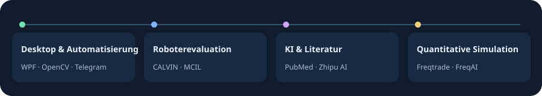

[简体中文](https://github.com/chenbinghan666/chenbinghan666/blob/main/README.md) · [English](https://github.com/chenbinghan666/chenbinghan666/blob/main/docs/locales/README.en.md) · [日本語](https://github.com/chenbinghan666/chenbinghan666/blob/main/docs/locales/README.ja.md) · **Deutsch** · [Français](https://github.com/chenbinghan666/chenbinghan666/blob/main/docs/locales/README.fr.md) · [Español](https://github.com/chenbinghan666/chenbinghan666/blob/main/docs/locales/README.es.md) · [Português](https://github.com/chenbinghan666/chenbinghan666/blob/main/docs/locales/README.pt.md)

## Ausgewählte Projekte

### [Desktop Agenda](https://github.com/chenbinghan666/desktop-agenda/blob/main/docs/locales/README.de.md)

Zeigt Google Kalender direkt auf dem Windows-Desktop an. Tages-, Wochen-, Monats- und Listenansicht helfen dabei, Kurse, Termine und Fristen im Blick zu behalten. Die Synchronisierung über iCal ist schreibgeschützt.

C# · WPF · Google Calendar · [Desktop-Kalender herunterladen](https://github.com/chenbinghan666/desktop-agenda/releases/latest) · [Demo](https://github.com/chenbinghan666/desktop-agenda/blob/main/docs/images/desktop-agenda-demo.gif)

### [CALVIN Failure Analysis](https://github.com/chenbinghan666/calvin-failure-analysis/blob/main/docs/locales/README.de.md)

An welchem Schritt scheitert ein Roboter, wenn keine der fünfstufigen Sequenzen gelingt? Mit dem CALVIN-Simulator und einem öffentlich verfügbaren MCIL-Modell untersuche ich Abweichungen bei den Aktionen und die Wiederaufnahme nach Fehlern. Mit Abbildungen, Daten und einem Bericht auf Chinesisch.

Python · CALVIN · MCIL · [Versuchsbericht lesen](https://github.com/chenbinghan666/calvin-failure-analysis/blob/main/docs/report.pdf)

Screenshot und Versuchsdiagramm anzeigen

## Windows und Automatisierung

- [**PBZ Map Markers Installer**](https://github.com/chenbinghan666/pbz-map-markers-installer/blob/main/docs/README.de.md) · Offline-Installer für Kartenmarkierungen unter Windows mit Prüfung, Sicherung und Wiederherstellung. Original-Mod von PaulGao. [Download](https://github.com/chenbinghan666/pbz-map-markers-installer/releases/latest)
- [**PUBG AFK Helper**](https://github.com/chenbinghan666/pubg-afk-helper/blob/main/docs/locales/README.de.md) · Erkennt PUBG-Bildschirme mit OpenCV, zeigt den Erkennungsstatus an und führt unter Windows konfigurierbare Abläufe aus. Enthält eine Vorschau ohne Eingaben und Offline-Regressionstests. · [Demo](https://github.com/chenbinghan666/pubg-afk-helper/blob/main/docs/images/project-demo.gif)
- [**Daily Mail Report Bot**](https://github.com/chenbinghan666/mail_digest_bot/blob/main/docs/locales/README.de.md) · Gruppiert Beispiel-E-Mails nach Absender und sendet einen Tagesbericht an Telegram. Mein erstes öffentliches Python-Projekt trennt die Berichtserstellung vom Nachrichtenversand.

## KI und Literatursuche

- [**Drug–Gene RAG**](https://github.com/chenbinghan666/drug-gene-rag/blob/main/docs/locales/README.de.md) · Nach Eingabe eines Gens, eines Wirkstoffs und einer Krebsart ruft das Tool PubMed-Abstracts ab. Ein Zhipu-Modell fasst die Hinweise auf Zusammenhänge zusammen. Gedacht für Lernzwecke und Literaturrecherche.

## Quantitative Forschung und Simulation

- [**Crypto AI Trading Lab**](https://github.com/chenbinghan666/crypto-ai-trading-lab/blob/main/docs/locales/README.de.md) · Chinesischsprachige Arbeitsumgebung für Backtests, FreqAI-Experimente und simulierten Futures-Handel. Regelbasierte und modellbasierte Strategien lassen sich über getrennte virtuelle Konten vergleichen. Der Einsatz ist auf Forschung und Simulation ausgelegt.

Meine Forks

- [so-novel](https://github.com/chenbinghan666/so-novel)
- [greenram](https://github.com/chenbinghan666/greenram)

