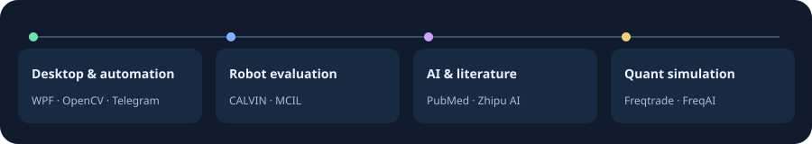

# Hi, I’m @chenbinghan666

[简体中文](https://github.com/chenbinghan666/chenbinghan666/blob/main/README.md) · **English** · [日本語](https://github.com/chenbinghan666/chenbinghan666/blob/main/docs/locales/README.ja.md) · [Deutsch](https://github.com/chenbinghan666/chenbinghan666/blob/main/docs/locales/README.de.md) · [Français](https://github.com/chenbinghan666/chenbinghan666/blob/main/docs/locales/README.fr.md) · [Español](https://github.com/chenbinghan666/chenbinghan666/blob/main/docs/locales/README.es.md) · [Português](https://github.com/chenbinghan666/chenbinghan666/blob/main/docs/locales/README.pt.md)

I build small tools for everyday workflows and research prototypes that make experimental results easier to inspect. Start with a desktop calendar you can download, a robot evaluation report you can read, or the source code behind either project.

## Featured projects

### [Desktop Agenda](https://github.com/chenbinghan666/desktop-agenda/blob/main/docs/locales/README.en.md)

Keep Google Calendar visible on your Windows desktop. Switch between day, week, month, and agenda views to check classes, meetings, and deadlines. Events sync read-only via iCal.

C# · WPF · Google Calendar · [Download Desktop Agenda](https://github.com/chenbinghan666/desktop-agenda/releases/latest)

### [CALVIN Failure Analysis](https://github.com/chenbinghan666/calvin-failure-analysis/blob/main/docs/locales/README.en.md)

Where does a robot go wrong when every five-step sequence fails? This study uses the CALVIN simulator and a public MCIL model to inspect action deviations and test recovery after failure. Includes figures, data, and a Chinese report.

Python · CALVIN · MCIL · [Read the experiment report](https://github.com/chenbinghan666/calvin-failure-analysis/blob/main/docs/report.pdf)

Show screenshot and results chart

## Windows & automation

- [**PUBG AFK Helper**](https://github.com/chenbinghan666/pubg-afk-helper/blob/main/docs/locales/README.en.md) · Uses OpenCV to recognize PUBG screens, show detection status, and run configurable workflows on Windows. Includes a detection-only preview and offline regression tests.
- [**Daily Mail Report Bot**](https://github.com/chenbinghan666/mail_digest_bot/blob/main/docs/locales/README.en.md) · Groups sample emails by sender and sends a daily report to Telegram. This was my first public Python project. Start with the report builder and the Telegram client to see how it works.

## AI & literature retrieval

- [**Drug–Gene RAG**](https://github.com/chenbinghan666/drug-gene-rag/blob/main/docs/locales/README.en.md) · Enter a gene, a drug, and a cancer type. The tool retrieves PubMed abstracts and uses a Zhipu model to summarize evidence of associations. Built for learning and literature exploration.

## Quantitative research & simulation

- [**Crypto AI Trading Lab**](https://github.com/chenbinghan666/crypto-ai-trading-lab/blob/main/docs/locales/README.en.md) · A Chinese-language workbench for backtesting, FreqAI experiments, and futures simulation. Compare rule-based and model-based strategies with separate virtual ledgers. The current scope is research and simulation.

Repositories I forked

- [so-novel](https://github.com/chenbinghan666/so-novel)
- [greenram](https://github.com/chenbinghan666/greenram)

