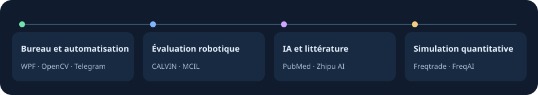

# Bonjour, je suis @chenbinghan666

[简体中文](https://github.com/chenbinghan666/chenbinghan666/blob/main/README.md) · [English](https://github.com/chenbinghan666/chenbinghan666/blob/main/docs/locales/README.en.md) · [日本語](https://github.com/chenbinghan666/chenbinghan666/blob/main/docs/locales/README.ja.md) · [Deutsch](https://github.com/chenbinghan666/chenbinghan666/blob/main/docs/locales/README.de.md) · **Français** · [Español](https://github.com/chenbinghan666/chenbinghan666/blob/main/docs/locales/README.es.md) · [Português](https://github.com/chenbinghan666/chenbinghan666/blob/main/docs/locales/README.pt.md)

Je crée de petits outils pour le quotidien et des prototypes de recherche qui permettent d’examiner les résultats en détail. Vous trouverez ici un calendrier de bureau à télécharger, un rapport d’évaluation robotique et le code source des projets.

## Projets à découvrir

### [Desktop Agenda](https://github.com/chenbinghan666/desktop-agenda/blob/main/docs/locales/README.fr.md)

Affiche Google Agenda sur le bureau Windows. Les vues jour, semaine, mois et liste facilitent le suivi des cours, réunions et échéances. La synchronisation via iCal se fait en lecture seule.

C# · WPF · Google Calendar · [Télécharger le calendrier](https://github.com/chenbinghan666/desktop-agenda/releases/latest)

### [CALVIN Failure Analysis](https://github.com/chenbinghan666/calvin-failure-analysis/blob/main/docs/locales/README.fr.md)

À quelle étape un robot échoue-t-il quand aucune séquence de cinq actions n’aboutit ? L’étude s’appuie sur le simulateur CALVIN et un modèle MCIL public pour examiner les écarts d’action et tester la reprise après échec. Le dépôt contient des figures, des données et un rapport en chinois.

Python · CALVIN · MCIL · [Lire le rapport expérimental](https://github.com/chenbinghan666/calvin-failure-analysis/blob/main/docs/report.pdf)

Afficher la capture et le graphique

## Windows et automatisation

- [**PUBG AFK Helper**](https://github.com/chenbinghan666/pubg-afk-helper/blob/main/docs/locales/README.fr.md) · Utilise OpenCV pour reconnaître les écrans de PUBG, afficher l’état de la détection et exécuter des séquences configurables sous Windows. Comprend un aperçu limité à la détection et des tests de régression hors ligne.
- [**Daily Mail Report Bot**](https://github.com/chenbinghan666/mail_digest_bot/blob/main/docs/locales/README.fr.md) · Regroupe des e-mails d’exemple par expéditeur et envoie un rapport quotidien sur Telegram. Mon premier projet Python public sépare la génération du rapport et l’envoi du message.

## IA et recherche bibliographique

- [**Drug–Gene RAG**](https://github.com/chenbinghan666/drug-gene-rag/blob/main/docs/locales/README.fr.md) · À partir d’un gène, d’un médicament et d’un type de cancer, l’outil récupère des résumés PubMed. Un modèle Zhipu synthétise les éléments qui étayent les associations. Conçu pour l’apprentissage et l’exploration de la littérature.

## Recherche quantitative et simulation

- [**Crypto AI Trading Lab**](https://github.com/chenbinghan666/crypto-ai-trading-lab/blob/main/docs/locales/README.fr.md) · Un espace de travail en chinois pour le backtesting, les expériences FreqAI et la simulation de contrats à terme. Des comptes virtuels distincts permettent de comparer des stratégies à règles et des stratégies fondées sur un modèle. Le projet est dédié à la recherche et à la simulation.

Dépôts que j’ai forkés

- [so-novel](https://github.com/chenbinghan666/so-novel)
- [greenram](https://github.com/chenbinghan666/greenram)

